

 

# <code>SHARON.exe</code>

### SOFTWARE DEVELOPER <code>×</code> PSICÓLOGA

**Building systems. Understanding people. Creating better experiences.**

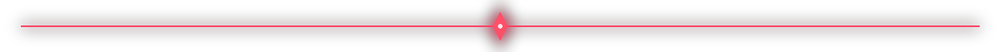

<table border="1" bordercolor="#ff304f" cellpadding="12" cellspacing="0">
<tr>
<td width="25%" valign="top" align="center">

### SHARON

**Software Developer**  
**Psicóloga**

Colombia · Remote-friendly

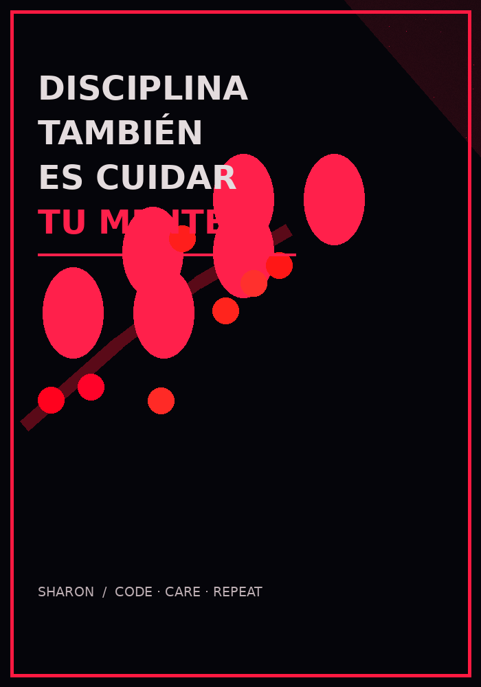

<a href="https://github.com/SOrtizRamirez">GitHub</a> · <a href="https://www.linkedin.com/in/sharonfullstack/">LinkedIn</a>

</td>
<td width="75%" valign="top">

## 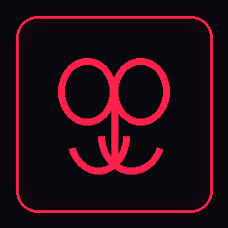 <code>01 / ABOUT ME</code>

---

Soy Sharon, **desarrolladora de software y psicóloga**. Combino el pensamiento analítico de la ingeniería con una mirada centrada en las personas.

Me gusta crear soluciones útiles, comprender cómo funcionan los sistemas y mejorar cada proyecto mediante práctica, investigación y atención al detalle.

<table>
  <tr>
    <td width="50%" valign="top">

**01 · THINK CRITICALLY**

Resolución de problemas, análisis y aprendizaje continuo.

</td>
    <td width="50%" valign="top">

**02 · BUILD WITH CARE**

Sistemas claros, mantenibles, seguros y útiles.

</td>
  </tr>
  <tr>
    <td width="50%" valign="top">

**03 · UNDERSTAND PEOPLE**

Una perspectiva humana para resolver necesidades reales.

</td>
    <td width="50%" valign="top">

**04 · KEEP EVOLVING**

Arquitectura, experiencia de usuario y ciberseguridad.

</td>
  </tr>
</table>

  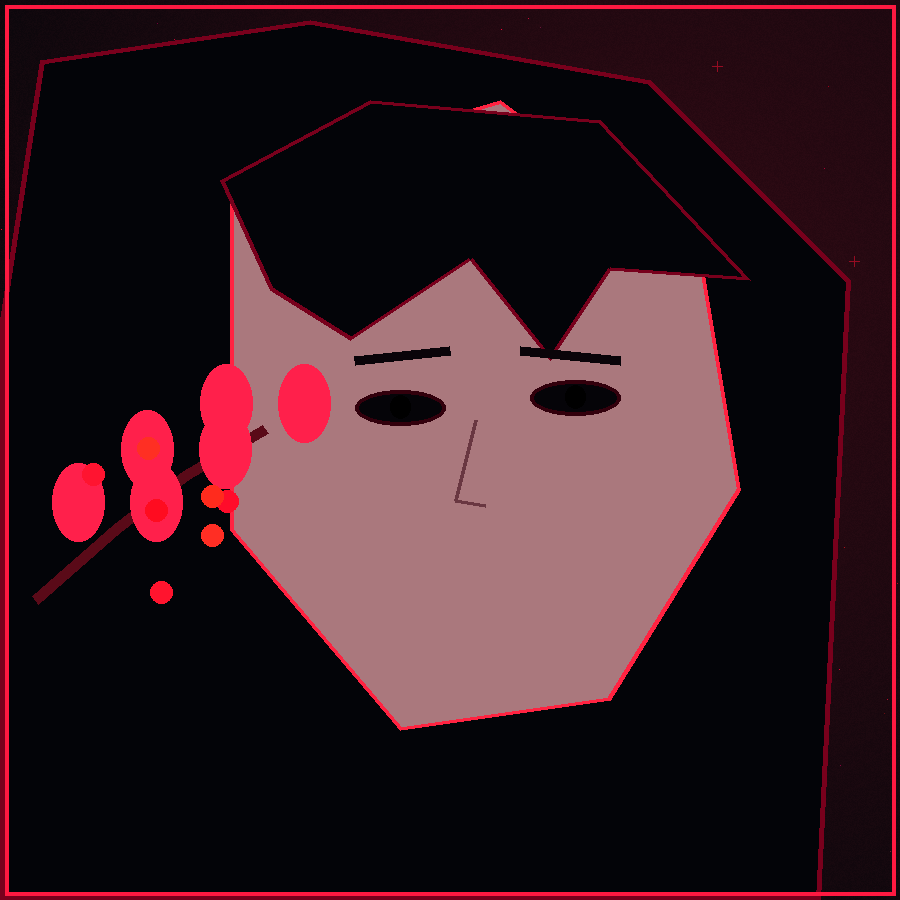

</td>
</tr>
</table>

## 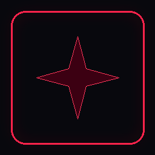 <code>02 / TECH ARSENAL</code>

<table border="1" bordercolor="#ff304f" cellpadding="12" cellspacing="0">
<tr>
<td width="22%" valign="middle"><strong>LANGUAGES & WEB</strong></td>
<td valign="middle">

</td>
</tr>
<tr>
<td valign="middle"><strong>DATABASES</strong></td>
<td valign="middle">

</td>
</tr>
<tr>
<td valign="middle"><strong>TOOLS & OS</strong></td>
<td valign="middle">

</td>
</tr>
</table>

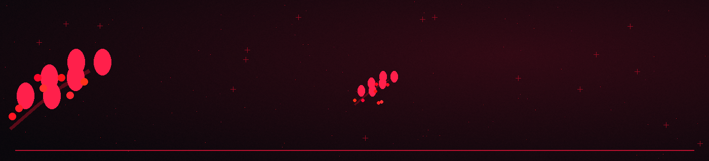

## 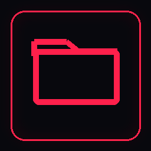 <code>03 / SELECTED PROJECTS</code>

<table border="1" bordercolor="#ff304f" cellpadding="12" cellspacing="0">
<tr>
<td width="50%" valign="top">

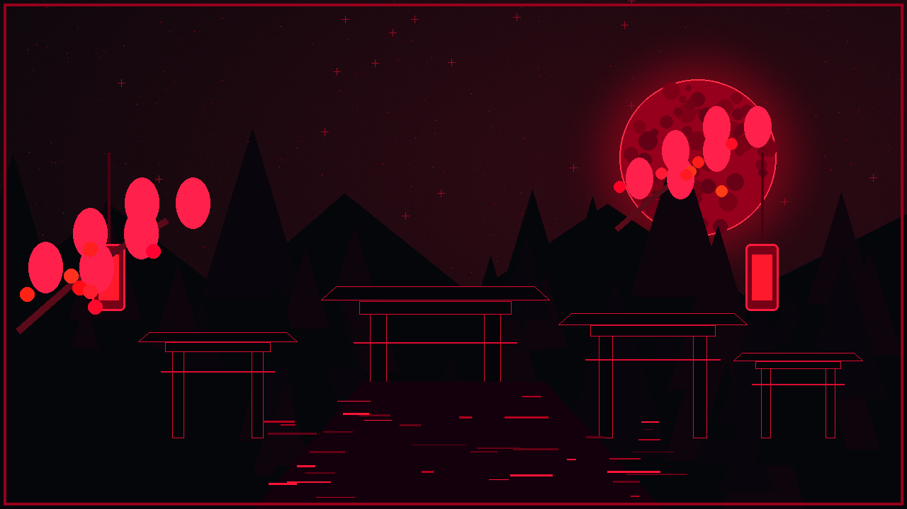

### `PROJECT_01` · NestJS E-commerce Backend

Backend de comercio electrónico con espacio para documentar autenticación, catálogo, pedidos, pagos y decisiones de arquitectura según las funcionalidades reales del repositorio.

[**↗ VER REPOSITORIO**](https://github.com/SOrtizRamirez/nestjs-ecommerce-backend)

</td>
<td width="50%" valign="top">

### `PROJECT_02` · Empleabilidad API

API relacionada con empleabilidad. Usa la descripción del proyecto para detallar sus casos de uso, endpoints y decisiones técnicas.

[**↗ VER REPOSITORIO**](https://github.com/SOrtizRamirez/empleabilidad-api)

</td>
</tr>
</table>

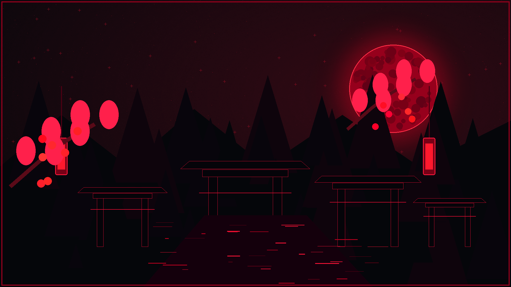

## 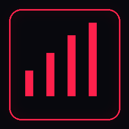 <code>04 / GITHUB TELEMETRY</code>

 

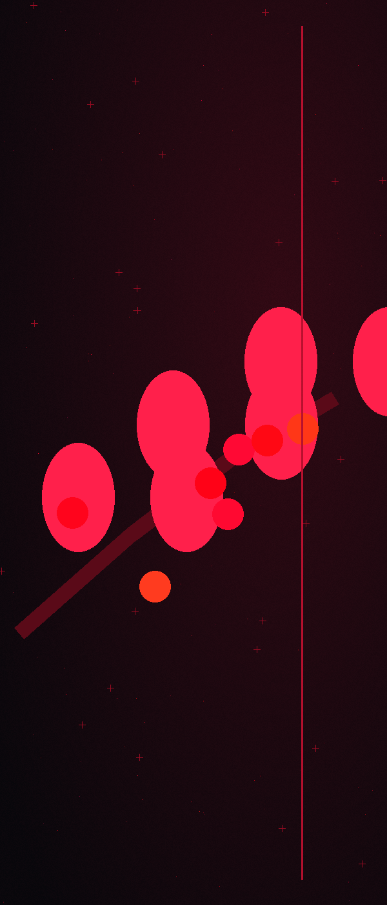

##  <code>05 / CONNECT</code>

**LET'S BUILD SOMETHING MEANINGFUL.**

<em>“A quieter mind builds louder things.”</em>

SOFTWARE × PSYCHOLOGY · DARK BY DEFAULT · BUILT WITH INTENTION

